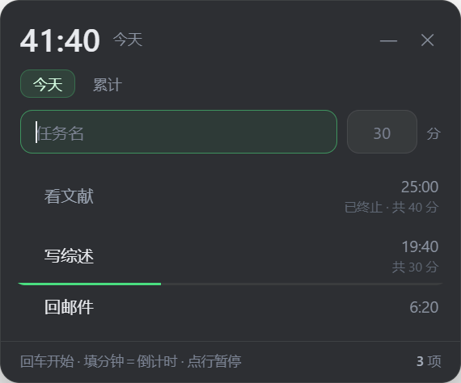
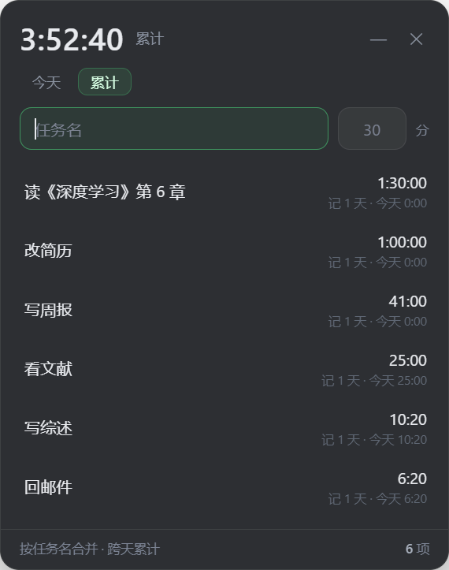

# 学习计时 · Study Timer

一个常驻桌面的极简学习计时器：**输入任务名回车就开始计时**，可以给任务设分钟数倒计时，到点提醒；所有任务按名字跨天累计学习时长。

Windows 桌面小工具，Electron 实现，零依赖、数据全本地、不联网。




---

## 功能

- **两种计时**：只填任务名 = 正计时；再填分钟数（如 `30`）= 从 30 分钟倒数。
- **到点提醒**：倒计时归零时播放自带提示音 + Windows 通知，窗口自动提到最前。窗口被遮挡、最小化都不影响。
- **按日期累计**：「累计」页按学习日分组，每天列出当天各任务时长和当天合计。
- **学习日不按零点切**：过了零点继续学，时长继续算在前一天；零点后**空闲满 2 小时**，下一段才归新的一天。正在跑的任务永远不会被边界切断。
- **暂停 / 继续**：点任务行本身，已用时间立刻结算，再点继续。
- **收工**：悬停点「收工」→ 再点「确认收工」，这条任务今天封账，之后当天不再累计（防止误触，需要点两下）。
- **收起成胶囊**：点标题栏的 `—` 缩成一颗 142×44 的小胶囊，只显示一个数字（倒计时剩余 / 正计时已用 / 今日合计），点一下展开。
- **隐藏到托盘**：点 `✕` 只是隐藏，计时继续；托盘左键显示/隐藏，右键「退出（结算计时）」。
- **窗口贴边置顶**：无边框、可拖动、位置记住，换分辨率会自动夹回屏幕内。
- **数据可读可迁**：`data/state.json` 是纯 JSON，整个文件夹拷走就能换机器；旁边还会自动维护一份 `data/daily.csv`（日期 / 任务名 / 秒数），拿去 Excel 或任意工具就能画图。
- **折线图**：不想让计时器变臃肿，所以图不在界面里画。每次保存会顺手生成 `data\chart.html`，双击就能看每天的折线和每条任务的曲线。

## 安装（Windows）

1. 打开 [Releases](https://github.com/tyro-qyh/study-timer/releases/latest)，下载 `study-timer-x.y.z.zip`。
2. 右键 zip → **全部解压缩**，解压到任意目录（建议 `D:\SOFTWARE`，别放在压缩包里直接运行）。
3. 进入解压出来的 `study-timer` 文件夹，**双击 `安装.cmd`**。
4. 等它跑完（首次会下载 Electron 运行时约 137 MB，解压后约 350 MB），桌面会出现「学习计时」。

双击桌面图标就能用了。安装脚本不写注册表、不开机自启、不做系统级改动。

> 也可以右键 `install.ps1` →「使用 PowerShell 运行」，效果一样。
>
> 如果首次启动时 Windows 弹出 SmartScreen「已保护你的电脑」，点「更多信息」→「仍要运行」（程序没有代码签名）。

### 手动运行

```powershell
runtime\electron.exe app
```

## 使用

| 想干什么 | 怎么做 |
| --- | --- |
| 开始正计时 | 任务名 → 回车（分钟留空） |
| 开始倒计时 | 任务名 + `30` → 回车 |
| 暂停 / 继续 | 点这一行 |
| 今天不再记这个任务 | 悬停 → 点「收工」→ 再点「确认收工」 |
| 删除当天记录 | 悬停 → 点 `✕` → 再点一次「确认删除」（会丢当天分钟） |
| 收起成胶囊 | 标题栏 `—`；点胶囊展开 |
| 暂时隐藏 | 标题栏 `✕` 或 `Alt+F4` |
| 彻底退出 | 托盘图标右键 →「退出（结算计时）」 |

计时精度：暂停/退出时精确到秒；进程被强杀时靠 15 秒心跳兜底，最多丢最后 15 秒。

跨零点：正在跑的那一段不会被切开，整段记在开始那天；零点后空满 2 小时，再开始才归新的一天。

## 数据与隐私

- 数据位置：`data/state.json`（相对程序目录），纯 JSON，可直接读改、可进 git、可迁移。
- 导出：每次落盘都会同步刷新 `data/daily.csv`，列是 `date,task,seconds`（UTF-8 带 BOM，Excel 直接双击能认）。只有**已收工**或**倒计时走完**的任务会进这份数据，运行中/暂停中的任务不算。完成过一次的任务会一直保留，第二段再跑时也还在（数值是已结算部分）。
- 不联网、不上传、无遥测、无账号。
- 历史保留最近 400 天，超出的最旧日期自动裁剪。
- 累计按「学习日 + 任务名」记，改名仍然算新任务。

## 看折线图

计时器本身不画图，只负责把数据准备好。**每次保存都会顺手生成 `data\chart.html`**，双击就能看：

- 一条「合计」线 + 每个任务一条自己的线，配色固定，图例点一下就能隐藏/显示。
- 只收录**已收工**或**倒计时走完**的任务；还在计时或只是暂停的任务不会出现在图里。
- 顶部可以切「全部 / 最近 30 天 / 最近 90 天」，右上角有区间合计和任务数。
- 「下载 SVG」可以存成矢量图，再转 PNG 也行。

`data\chart.html` 是自包含的（数据内嵌），拷给别人也能打开。另外 `tools\daily-chart.html` 是同一个页面的空白版，可以自己拖入任意 `daily.csv` 看别的账本。

## 已知限制

- 仅 Windows（脚本用 PowerShell + .lnk 快捷方式；应用本身跨平台，改一下启动方式即可）。
- 运行时体积较大（Electron 约 350 MB），这是"不用装浏览器/不用开 IDE 就能跑"的代价。
- 没有云端同步、没有多设备、没有报表导出——这是刻意的，保持一件事做好。

## 结构

```
study-timer/
├─ app/              应用本体
│  ├─ main.js        主进程：窗口、托盘、计时状态机、通知、daily.csv 导出
│  ├─ preload.js     contextBridge 暴露的最小 IPC
│  ├─ index.html     界面（无框架，原生 DOM）
│  ├─ assets/chime.wav 到点提示音
│  ├─ package.json
│  └─ tray.png       托盘图标
├─ tools/
│  └─ daily-chart.html 折线图页面（零依赖，可单独打开拖入 CSV）
├─ install.ps1       Windows 一键安装
├─ screenshots/
└─ data/             运行后生成（不纳入版本库）
```

## English

A minimal always-on-top study timer for Windows. Type a task name and hit Enter to count up; add minutes (e.g. `30`) to count down with a chime at zero. The totals page groups time by study day: a day does not roll over at midnight while you are still working, and only advances after a 2-hour idle gap. Data lives in `data/state.json` — local, plain JSON, no network, no telemetry.

Install: download the ZIP, run `install.ps1` in PowerShell (it fetches the Electron runtime on first run), then launch from the desktop shortcut.

## 更新日志

见 [CHANGELOG.md](CHANGELOG.md)。

## License

MIT